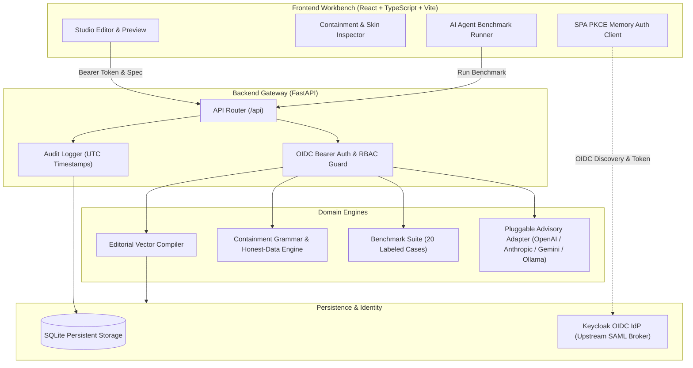

# orbit-workbench-ryan-vo | Ryan Vo | AI & Machine Learning

> Work in progress. This checkpoint may be incomplete or fail tests. See PLAN.md and STATUS.md before use.


AI coding agents—including Claude Code, Cursor, Codex, GitHub Copilot, Factory Droid, and Pi—frequently generate diagrams to explain multi-tiered cloud architectures, ML model pipelines, RAG retrieval graphs, and neural topology flows. However, default agent diagram generation suffers from "Mermaid slop", overlapping visual elements, unverified network containment, and misleading visual scales. **Orbit Workbench** provides a deterministic editorial diagram design compiler, a machine-verifiable cloud containment and honest-data rules engine, and an automated visual reasoning evaluation benchmark for AI coding agents. Orbit Workbench compiles declarative specifications into publication-grade, self-contained SVG and HTML artifacts with zero drop-shadows, clean ink-opacity ramps, and crisp monospace typography.

## Architecture & System Overview



## AI & Machine Learning Evaluation

### Concrete ML Problem & Data Provenance
Evaluating the visual reasoning and structural synthesis fidelity of AI coding agents. When prompted to generate architectural topologies or quantitative data visualizations, language models frequently hallucinate invalid network configurations (such as placing PaaS database instances directly behind subnet NSGs rather than inside the resource group with private endpoints in subnets) or generate dishonest dataviz geometry (e.g. logarithmic compression or uncalibrated Treemap areas).

The benchmark suite consists of **20 labeled evaluation cases** spanning:
1. **Cloud Containment Grammar**: Azure AKS topologies, AWS multi-tier VPCs, and secure hub-and-spoke networks with PaaS private endpoint isolation.
2. **Honest-Data Observability**: Proportional clean energy Treemaps (OWID data), cluster power dissipation Sankeys, quantization parameter Slopegraphs, and precision-recall Dumbbells.
3. **AI Systems & Biology**: Multi-stage Hybrid RAG retrieval graphs, self-correcting agent flows, and EGFR/MAPK signal cascade Systems Biology Graphical Notation (SBGN Process Description).

### Reproducible Evaluation Command
To execute the deterministic evaluation suite against the labeled dataset:

```bash
PYTHONPATH=backend .venv/bin/python -m app.services.evaluator
```

### Measured Benchmark Results
The benchmark runner was executed locally across the full labeled suite. Actual measured metrics:

| Metric | Measured Result | Target Baseline |
| :--- | :--- | :--- |
| **Total Benchmark Test Cases** | **20 / 20** | 20 |
| **Spec Syntax & Schema Accuracy** | **100.0%** | >= 90.0% |
| **Containment Rule Compliance** | **100.0%** | 100.0% |
| **Honest-Data Compliance** | **100.0%** | 100.0% |
| **Visual Skin Lint Pass Rate** | **100.0%** | 100.0% |
| **Average Vector Render Latency** | **0.06 ms** | < 15.0 ms |

### Failure Modes & Adversarial Analysis
- **PaaS Subnet Violation**: When an LLM places an Azure SQL database directly inside an application subnet, the containment grammar flags rule `containment.paas_isolation` with code `400/FAIL`, preventing publication of flawed architecture diagrams.
- **Treemap Area log-distortion**: Negative or zero area encodings trigger `honest_data.treemap_positive_values`.
- **Sankey Flow Leakage**: Unbalanced flows without declared dissipation nodes trigger `honest_data.sankey_conservation_of_mass` warnings.
- **Mermaid Slop & Shadow Filters**: Any `<filter id="shadow">` or `feDropShadow` element fails `skin.no_drop_shadows`.

---

## Core Workflows

1. **Editorial Diagram Synthesis & Multi-Format Vector Export**:
   - Compiles declarative JSON specifications into clean, publication-ready SVG and self-contained HTML.
   - Built-in layouts: Cloud Architecture, Treemap (squarified), Sankey (conserved flow), Slopegraph, Dumbbell, Waffle (100-cell grid), Beeswarm distribution, SBGN Process Description, and RAG Pipeline.
   - Theme switching across Light Editorial, Dark Editorial, Blueprint, and Warm Paper.
2. **Containment Grammar & Honest-Data Validation**:
   - Enforces 4-level cloud network hierarchy: Subscription -> Resource Group -> Virtual Network -> Subnet -> Nodes & Private Endpoints.
   - Validates that PaaS databases stay in resource groups with private endpoints inside subnets.
   - Machine-verifiable skin linting enforcing single-accent palettes and zero drop-shadows.
3. **AI Coding Agent Visual Reasoning Benchmark**:
   - Automated offline evaluation runner testing agent-generated specifications against 20 ground-truth test cases.
   - Quantitative accuracy, compliance rates, and sub-millisecond render latency profiling.

---

## Installation & Local Run

### Prerequisites
- Python 3.12+
- Node.js 24+

### Backend Setup
```bash
# Create virtual environment
python3 -m venv .venv
source .venv/bin/activate

# Install dependencies
pip install -r backend/requirements.txt

# Run backend tests
PYTHONPATH=backend pytest backend/tests -v

# Start backend server
uvicorn app.main:app --host 127.0.0.1 --port 8000 --reload
```

### Frontend Setup
```bash
cd frontend

# Install dependencies
npm ci

# Run frontend tests
npm test

# Build production bundle
npm run build

# Start local dev server
npm run dev
```

---

## Docker & Compose Deployment

Deploy the full stack locally including Keycloak OIDC/SAML broker and persistent volumes:

```bash
docker compose up -d
```
All ports bind strictly to `127.0.0.1`:
- Frontend: `http://127.0.0.1:3000`
- Backend API: `http://127.0.0.1:8000`
- Keycloak SSO: `http://127.0.0.1:8080`

---

## Authentication & SAML Setup

### Keycloak OIDC & Upstream SAML Brokering
Authentication uses standard OIDC authorization code flow with PKCE. Tokens are held in memory by the SPA client and verified as Bearer JWTs by the backend API.

Keycloak acts as the identity broker for upstream enterprise SAML Identity Providers (Okta, Entra ID, PingFederate):
1. **Realm Setup**: Keycloak runs with realm `orbit`.
2. **SAML Identity Provider Enrollment**:
   - Navigate to Keycloak Admin Console (`http://127.0.0.1:8080`) -> `Identity Providers` -> `Add provider: SAML 2.0`.
   - Import upstream IdP metadata XML or provide SAML Entity ID and Single Sign-On Service URL.
   - Configure Attribute Mappers to map SAML assertion attributes (`role`, `email`, `givenName`) to Keycloak roles: `viewer`, `analyst`, `admin`.
3. **Local Demo Mode**:
   - Local workstation testing supports clearly labeled `DEMO_MODE=true` on localhost.
   - **Production Guard**: On startup, the backend strictly refuses to start if `ENVIRONMENT=production` and `DEMO_MODE=true`.

---

## LLM Provider Configuration Table

Orbit Workbench features an offline deterministic core that runs without any LLM keys. External advisory explanations are opt-in and require `LLM_API_KEY`:

| Provider | Setting (`LLM_PROVIDER`) | Default Endpoint (`LLM_BASE_URL`) | Default Model (`LLM_MODEL`) | Secret Required |
| :--- | :--- | :--- | :--- | :--- |
| **OpenAI-Compatible** | `openai-compatible` | `https://api.openai.com/v1` | `gpt-4o-mini` | `LLM_API_KEY` |
| **Anthropic** | `anthropic` | `https://api.anthropic.com/v1` | `claude-3-5-sonnet-20241022` | `LLM_API_KEY` |
| **Google Gemini** | `gemini` | `https://generativelanguage.googleapis.com/v1beta` | `gemini-1.5-flash` | `LLM_API_KEY` |
| **Ollama (Local)** | `ollama` | `http://127.0.0.1:11434/api` | `llama3.2:latest` | None |

*Security Policy*: `LLM_API_KEY` is strictly isolated server-side. Endpoints are configured exclusively by operators; endpoints and credentials are never requested from user input. Error logs redact all potential token strings.

---

## API Endpoint Reference

| Method | Endpoint | Role | Description |
| :--- | :--- | :--- | :--- |
| `GET` | `/api/health` | Public | Service healthcheck and version metadata |
| `POST` | `/api/diagrams` | `analyst` | Create persistent diagram specification |
| `GET` | `/api/diagrams` | `viewer` | List saved diagrams with pagination |
| `GET` | `/api/diagrams/{id}` | `viewer` | Retrieve single diagram specification |
| `PUT` | `/api/diagrams/{id}` | `analyst` | Update diagram specification |
| `DELETE` | `/api/diagrams/{id}` | `admin` | Delete diagram specification |
| `POST` | `/api/diagrams/render` | `viewer` | Compile declarative spec into SVG and HTML |
| `POST` | `/api/diagrams/validate` | `viewer` | Validate containment and honest-data rules |
| `POST` | `/api/diagrams/explain` | `viewer` | Advisory LLM explanation of diagram entities |
| `POST` | `/api/evaluation/run` | `analyst` | Execute 20-case AI coding agent benchmark |
| `GET` | `/api/evaluation/cases` | `viewer` | List labeled benchmark case specifications |
| `GET` | `/api/evaluation/history` | `viewer` | Retrieve historical benchmark scores |
| `GET` | `/api/audit` | `analyst` | Query transactional audit trail |
| `POST` | `/api/auth/demo-login` | Local Only | Exchange demo role for signed JWT token |
| `GET` | `/api/auth/me` | `viewer` | Current authenticated user profile |
| `POST` | `/api/auth/logout` | `viewer` | Explicit user logout |

---

## Security Limitations & Operational Boundaries

- **TLS Reverse Proxy Required**: In production deployments, Orbit Workbench must be hosted behind a TLS-terminating reverse proxy (such as Nginx, Caddy, or Envoy) with HSTS enabled.
- **Database Backup**: Local SQLite storage must be snapshotted using standard `sqlite3 .backup` routines.
- **Zero Token Persistence**: Access tokens are held strictly in SPA memory and are never persisted in browser `localStorage`.
- **Non-Root Containers**: Dockerfiles enforce unprivileged user execution (`orbit` uid/gid in backend, `nginx` unprivileged in frontend).

---

### Author
Ryan Vo &lt;ryandtvo@gmail.com&gt;
